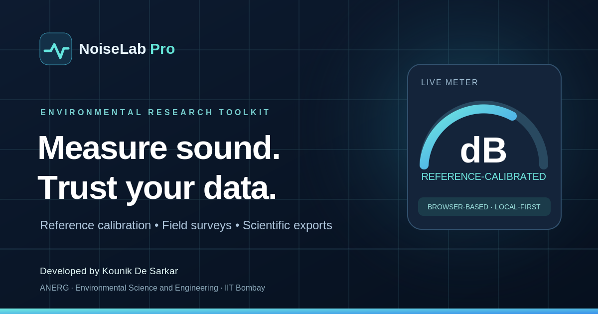

# NoiseLab Pro — Environmental Sound Measurement & Field Survey PWA

**Developer:** Kounik De Sarkar · Ph.D. Research Scholar, Air & Noise Exposure Research Group (ANERG), Environmental Science and Engineering Department, IIT Bombay.

**Mentors:** Prof. Harish C. Phuleria and Prof. Arnab Jana.  
**Homepage:** https://sites.google.com/view/kounik



A mobile-responsive, browser-based **screening and field research tool** for environmental acoustics. No server, signup, subscription, API key, or remote storage is required. Raw microphone audio is *never recorded, uploaded, or saved* by the application.

## What's included

- `index.html`: complete responsive application UI and original developer/mentor footer.
- `assets/app.js`: live metering UI, reference comparisons, calibration profiles, survey statistics, GPS, storage, reporting and exports.
- `assets/audio-worklet.js`: continuous Web Audio signal-power analysis, A/C/Z frequency weighting and FAST/SLOW digital time averaging.
- `assets/styles.css`: dark professional scientific dashboard theme.
- `favicon.svg`, `icon-192.png`, `icon-512.png`, `apple-touch-icon.png`: original square app logo, PWA and shortcut icons.
- `og-preview.png`: 1200×630 WhatsApp/Facebook/LinkedIn sharing banner.
- `manifest.webmanifest` and `sw.js`: installable PWA metadata and offline application-shell cache.
- `CALIBRATION_PROTOCOL.md`: safety, usage and scientific validity limitations.
- `tests/dsp.test.mjs`: signal processing smoke tests with generated tones.

## Upload to GitHub Pages

1. On GitHub, create a **public repository**, e.g. `NoiseLab-Pro`.
2. Unzip and upload **every file and folder into the repository root**, keeping `index.html` at the root. **Do not upload only the ZIP** if GitHub Pages is expected to host the HTML.
3. Open **Settings → Pages → Build and deployment → Deploy from a branch → main → /(root)**, then save.
4. Open the published HTTPS URL, typically `https://YOUR-GITHUB-USERNAME.github.io/NoiseLab-Pro/` (the exact URL depends on your account/repository).
5. To make the social-media preview reliable, update **both** `og:image` and `twitter:image` in `index.html` to an **absolute HTTPS address** of your published `og-preview.png`. For example:
   ```html
   <meta property="og:image" content="https://YOUR-GITHUB-USERNAME.github.io/NoiseLab-Pro/og-preview.png">
   <meta name="twitter:image" content="https://YOUR-GITHUB-USERNAME.github.io/NoiseLab-Pro/og-preview.png">
   ```
6. Test link sharing with a new URL after social networks refresh their preview cache. The logo and preview are included; previews are displayed by external platforms and may be cached.

For a local development preview: run `python -m http.server 8000` in the repository folder and open `http://localhost:8000`. **Opening `index.html` directly as a `file://` URL does not support AudioWorklet reliably.**

## First-use guide

1. Open the site in a modern Chrome, Edge, Firefox or Safari browser over HTTPS, ideally on a phone with a suitable external microphone.
2. Choose the microphone, press **Start microphone**, and grant permission.
3. Confirm in the **Measurement chain** panel that audio enhancements such as AGC, echo cancellation and noise suppression are disabled. The browser's reported settings may not reveal all hardware or OS processing.
4. Open **Calibration laboratory**. Compare the microphone with a trustworthy reference sound level meter under controlled, stable sound levels, press **Capture 10 s calibration** while simultaneously running the reference SLM. **After** the 10 seconds, enter the reference meter's LAeq for that exact interval, then press **Add paired observation**.
5. Repeat at different sound levels; **Save & activate profile**. Carry out additional **Independent validation** measurements not used to derive the offset.
6. Return to **Live meter**, enter project/site information and begin a survey. If browser-reported speech audio enhancements are active, the app warns and requires explicit confirmation to continue as a **low-confidence screening** survey with a stored quality flag.
7. **Finish & save**. Export CSV, generate a print-to-PDF HTML report, or download all saved surveys as JSON backup from the Saved surveys tab.
8. For georeferencing, explicitly click **Get GPS location**. No GPS collection happens automatically.

## Scientific limitations — read before use

**NoiseLab Pro is not a certified sound level meter, not IEC 61672 Class 1 or Class 2, and is not appropriate by itself for statutory compliance assessments or occupational exposure decisions.** Calibration against a reference meter produces a device/path-specific **empirical level offset**; it does not fix unknown microphone frequency response, nonlinear gain, wind sensitivity, clipping, hidden OS enhancements, or temperature effects. An acoustic calibrator generally does not couple correctly to built-in smartphone microphones.

- Without a valid matching calibration profile, the live meter shows **dBFS**, not dB SPL. It intentionally prevents storing a dB(A) field survey.
- The A/C filters are **digital approximations**, bilinear transformed from standard analogue pole frequencies and normalized at 1 kHz, **not independently certified** IEC weighting networks. Z is unweighted.
- FAST (0.125 s) and SLOW (1 s) smoothing are exponential averages of squared samples. A-weighted LAeq,T is energy-averaged over the actual processed audio frames.
- L10/L50/L90 are **sampled percentiles of 100 ms FAST values**; these are exploratory estimates. LAFmin/LAFmax use those same sampled readings and can miss true faster extrema.
- The calibration offset comes from a 10-second reference LAeq comparison, calculated as `reference dBA − A-weighted digital level dBFS`. The **median** of paired offsets is saved. Independent validation error is the corrected measurement minus the reference value.
- The same 1 kHz-referenced sensitivity offset is also displayed for C and Z measurement **for exploration only**. It is not a frequency-dependent calibration or true peak validation.
- Browser-internal audio capture and OS audio processing may defeat requested settings. The app detects settings that are exposed, but cannot validate all of them.
- Browser tab throttling, screen locking, phone calls, USB disconnects or power restrictions may interrupt the data stream. Keep the app foregrounded and the screen unlocked while recording.
- Per-second CSV bins are assembled from complete 100 ms processing blocks, so interval boundaries may differ from exactly 1.000 seconds by up to one processing block; the precise processed duration is preserved.
- The app displays Indian residential/commercial/industrial/silence-zone limits only for **indicative comparison**. These are not automatically valid legal compliance verdicts.
- Sessions and calibration profiles are stored in the current browser profile only. Use JSON backup; clearing browser data can remove sessions. GPS accuracy is device-dependent.

## Research validation before publication use

Compare several devices/microphones against a calibrated Class 1/2 SLM over independent sound-level steps and traffic/tonal/broadband conditions. Inspect frequency response, clipping, directionality, wind handling, inter-device variability, effects of browser updates, temperature, device orientation, measurement uncertainty, time weighting and long-term measurement stability. Retain raw reference instrument data separately. See `CALIBRATION_PROTOCOL.md`.

## Source references

- [NIOSH sound level meter app and its validation limitations (CDC)](https://www.cdc.gov/niosh/noise/about/app.html)
- [Web Audio API / AudioWorklet documentation (MDN)](https://developer.mozilla.org/en-US/docs/Web/API/Web_Audio_API)
- [India noise pollution rules and day/night reference values (CPCB)](https://cpcb.nic.in/displaypdf.php?id=Tm9pc2UtU3RhbmRhcmRzL25vaXNlX3J1bGVzXzIwMDAucGRm)

## License

Code is provided in this ZIP for the recipient to use, edit and host. Attribution is retained in the footer as requested. No external libraries or bundled proprietary assets.
